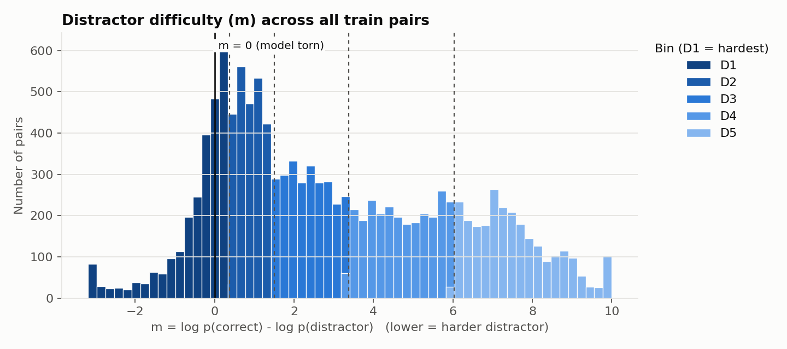
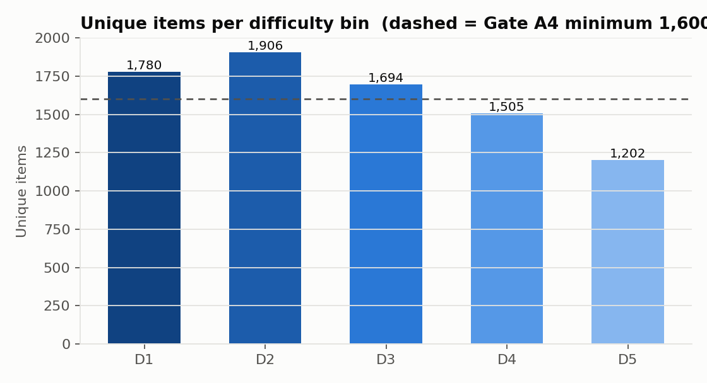
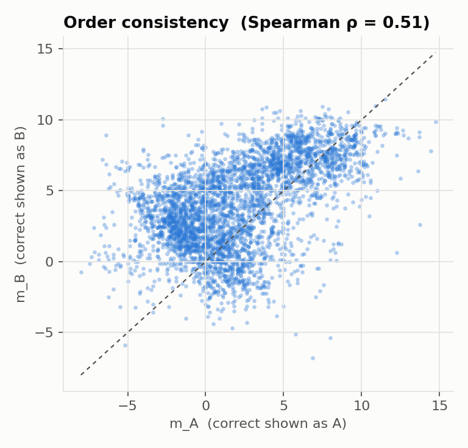

# 데이터셋 구축 결과 보고 (smolvlm)

## 1. 원본 데이터 (ScienceQA, 이미지 포함 문항)
| split | 문항 수 |
|---|---|
| train | 6218 |
| validation | 2097 |
| test | 2017 |

train 오답 쌍: **12,806개**

### 선택지 개수(K) 분포 (train)
| K | 문항 수 | 비율 |
|---|---|---|
| K=2 | 2071 | 33.3% |
| K=3 | 1816 | 29.2% |
| K=4 | 2221 | 35.7% |
| K=5 | 110 | 1.8% |

### 과목·학년대 층 분포 (train)
| 층 | 문항 수 | 비율 |
|---|---|---|
| natural science|G1-6 | 2564 | 41.2% |
| social science|G1-6 | 1704 | 27.4% |
| natural science|G7-12 | 1272 | 20.5% |
| social science|G7-12 | 542 | 8.7% |
| language science|G1-6 | 81 | 1.3% |
| language science|G7-12 | 55 | 0.9% |

## 2. 오답 난이도 측정
- 측정 모델: 학습 전 HuggingFaceTB/SmolVLM-500M-Instruct
- 정답 글자 형식: `space`
- val500 정확도: **0.642** (찍기 정확도 0.359)
- m = 정답 로그확률 − 오답 로그확률 (정답 위치를 바꾼 두 프롬프트의 평균). 작을수록 어려운 오답.

| 구간 | m 범위 | 평균 m | 오답 쌍 수 | 고유 문항 수 |
|---|---|---|---|---|
| D1 | -5.750 ~ 0.375 | -0.484 | 2556 | 1780 |
| D2 | 0.375 ~ 1.500 | 0.893 | 2547 | 1906 |
| D3 | 1.500 ~ 3.375 | 2.365 | 2559 | 1694 |
| D4 | 3.375 ~ 6.031 | 4.719 | 2582 | 1505 |
| D5 | 6.031 ~ 13.375 | 7.546 | 2562 | 1202 |

## 3. 관문 A (측정 타당성)
| 항목 | 결과 | 값 | 기준 |
|---|---|---|---|
| A1_기저실력 | 통과 | 0.642 | >= 0.459 |
| A2_천장 | 통과 | 0.642 | <= 0.85 |
| A3_순서일치 | 통과 | 0.506 | >= 0.5 |
| A4_구간크기 | 미통과 | {'D1': 1780, 'D2': 1906, 'D3': 1694, 'D4': 1505, 'D5': 1202} | 모든 구간 >= 1600 |

> **관문 A4 미통과 대응 (계획서 3.3):** 가장 작은 구간이 1,202문항이므로 학습 세트 최대 크기 N_max를 1,600 → 1,200로 낮추었다. 규모 격자: [100, 200, 400, 800, 1200]

D1 수작업 검수: 추후 진행 예정.

## 3-1. 2단계 보완 항목

### 구간별 과목 분포 (오답 쌍 기준)
| 구간 | language science | natural science | social science |
|---|---|---|---|
| D1 | 3% | 86% | 12% |
| D2 | 3% | 67% | 30% |
| D3 | 2% | 51% | 47% |
| D4 | 1% | 22% | 77% |
| D5 | 0% | 8% | 92% |
| 전체 | 2% | 47% | 51% |

### 구간별 학년대 분포 (오답 쌍 기준)
| 구간 | G1-6 | G7-12 |
|---|---|---|
| D1 | 53% | 47% |
| D2 | 58% | 42% |
| D3 | 68% | 32% |
| D4 | 83% | 17% |
| D5 | 80% | 20% |
| 전체 | 69% | 31% |

### 구간별 선택지 수 K 분포 (오답 쌍 기준)
| 구간 | 2 | 3 | 4 | 5 |
|---|---|---|---|---|
| D1 | 27% | 46% | 13% | 14% |
| D2 | 29% | 36% | 33% | 3% |
| D3 | 17% | 34% | 48% | 0% |
| D4 | 6% | 19% | 75% | 0% |
| D5 | 2% | 7% | 90% | 0% |
| 전체 | 16% | 28% | 52% | 3% |

### 구간별 hint 유무 분포 (오답 쌍 기준)
| 구간 | False | True |
|---|---|---|
| D1 | 10% | 90% |
| D2 | 20% | 80% |
| D3 | 42% | 58% |
| D4 | 80% | 20% |
| D5 | 96% | 4% |
| 전체 | 50% | 50% |

**구간별 가장 큰 쏠림** (구간 비율 − 전체 비율): D1 subject=social science -40%, D2 subject=social science -22%, D3 subject=social science -4%, D4 subject=social science +26%, D5 subject=social science +40%

- 정답 글자 형식 config.yaml 기록: `space`
- 로그확률 4개 값(lp): 미저장 (m_A, m_B 차이값만 저장)
- val·test 문항 난이도 계산 완료 (분석 전용). validation 2097문항: 학습 전 정확도 0.633, 평균 margin 1.086. test 2017문항은 계산만 하고 본실험 분석 전까지 열람하지 않음

## 4. 학습 세트 구성
- 생성 파일: 105개 (조건 7 × 규모 5 × 시드 3)
- 자동 검증 결과:

| 검증 | 결과 |
|---|---|
| 1_중복없음 | 통과 |
| 2_중첩성 | 통과 |
| 3_정답위치균형 | 통과 |
| 4_층비율 | 경고 있음 (로그 참고) |
| 5_난이도순서 | 통과 |

### 조건별 과목 구성 (N=1200, seed 0)
| 조건 | language science | natural science | social science | 층 대체 비율 |
|---|---|---|---|---|
| 목표 (train 전체) | 2% | 62% | 36% | - |
| Rand | 2% | 62% | 36% | 0% |
| D1 | 4% | 79% | 17% | 21% |
| D2 | 5% | 65% | 30% | 8% |
| D3 | 2% | 62% | 36% | 0% |
| D4 | 1% | 36% | 63% | 32% |
| D5 | 0% | 13% | 86% | 56% |
| Full | 2% | 62% | 36% | 0% |

> 난이도 구간과 과목이 함께 움직인다: 쉬운 오답(D4·D5)은 social science에, 어려운 오답(D1)은 natural science에 몰려 있어, 목표 과목 비율을 맞추지 못한 자리는 다른 과목 문항으로 대체되었다. 결과 해석 시 과목 효과와 난이도 효과가 섞일 수 있으므로 과목별 정확도를 함께 보고한다.

