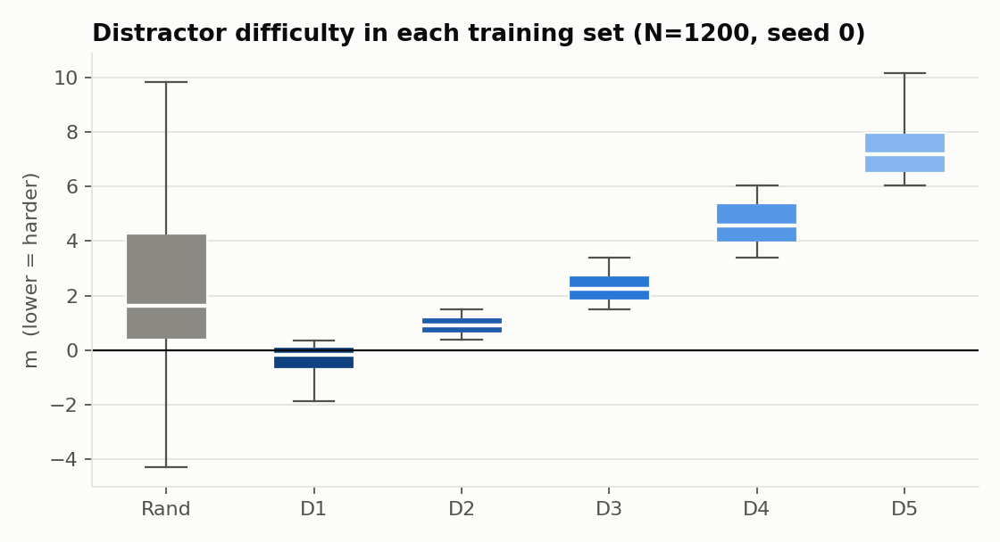

# 데이터셋 구축 결과 보고 (smolvlm)

## 1. 원본 데이터 (ScienceQA, 이미지 포함 문항)
| split | 문항 수 |
|---|---|
| train | 6218 |
| validation | 2097 |
| test | 2017 |

train 오답 쌍: **12,806개**

### 선택지 개수(K) 분포 (train)
| K | 문항 수 | 비율 |
|---|---|---|
| K=2 | 2071 | 33.3% |
| K=3 | 1816 | 29.2% |
| K=4 | 2221 | 35.7% |
| K=5 | 110 | 1.8% |

### 과목·학년대 층 분포 (train)
| 층 | 문항 수 | 비율 |
|---|---|---|
| natural science|G1-6 | 2564 | 41.2% |
| social science|G1-6 | 1704 | 27.4% |
| natural science|G7-12 | 1272 | 20.5% |
| social science|G7-12 | 542 | 8.7% |
| language science|G1-6 | 81 | 1.3% |
| language science|G7-12 | 55 | 0.9% |

## 2. 오답 난이도 측정
- 측정 모델: 학습 전 HuggingFaceTB/SmolVLM-500M-Instruct
- 정답 글자 형식: `space`
- val500 정확도: **0.642** (찍기 정확도 0.359)
- m = 정답 로그확률 − 오답 로그확률 (정답 위치를 바꾼 두 프롬프트의 평균). 작을수록 어려운 오답.

| 구간 | m 범위 | 평균 m | 오답 쌍 수 | 고유 문항 수 |
|---|---|---|---|---|
| D1 | -5.750 ~ 0.375 | -0.484 | 2556 | 1780 |
| D2 | 0.375 ~ 1.500 | 0.893 | 2547 | 1906 |
| D3 | 1.500 ~ 3.375 | 2.365 | 2559 | 1694 |
| D4 | 3.375 ~ 6.031 | 4.719 | 2582 | 1505 |
| D5 | 6.031 ~ 13.375 | 7.546 | 2562 | 1202 |

## 3. 관문 A (측정 타당성)
| 항목 | 결과 | 값 | 기준 |
|---|---|---|---|
| A1_기저실력 | 통과 | 0.642 | >= 0.459 |
| A2_천장 | 통과 | 0.642 | <= 0.85 |
| A3_순서일치 | 통과 | 0.506 | >= 0.5 |
| A4_구간크기 | 미통과 | {'D1': 1780, 'D2': 1906, 'D3': 1694, 'D4': 1505, 'D5': 1202} | 모든 구간 >= 1600 |

> **관문 A4 미통과 대응 (계획서 3.3):** 가장 작은 구간이 1,202문항이므로 학습 세트 최대 크기 N_max를 1,600 → 1,200로 낮추었다. 규모 격자: [100, 200, 400, 800, 1200]

D1 수작업 검수: 추후 진행 예정.

## 4. 학습 세트 구성
- 생성 파일: 105개 (조건 7 × 규모 5 × 시드 3)
- 자동 검증 결과:

| 검증 | 결과 |
|---|---|
| 1_중복없음 | 통과 |
| 2_중첩성 | 통과 |
| 3_정답위치균형 | 통과 |
| 4_층비율 | 경고 있음 (로그 참고) |
| 5_난이도순서 | 통과 |

- 층 대체 횟수(조건_시드별): {'Rand_s0': 0, 'D1_s0': 256, 'D2_s0': 95, 'D3_s0': 0, 'D4_s0': 381, 'D5_s0': 673, 'Full_s0': 0, 'Rand_s1': 0, 'D1_s1': 256, 'D2_s1': 95, 'D3_s1': 0, 'D4_s1': 381, 'D5_s1': 673, 'Full_s1': 0, 'Rand_s2': 0, 'D1_s2': 256, 'D2_s2': 95, 'D3_s2': 0, 'D4_s2': 381, 'D5_s2': 673, 'Full_s2': 0}

