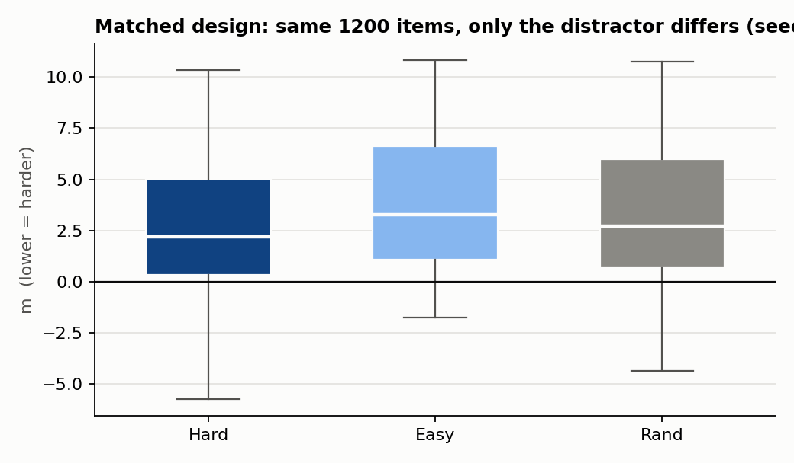

# 문항 일치 설계 (같은 문제, 다른 오답) — smolvlm

모든 조건이 **완전히 같은 문항을 같은 순서로** 쓰고, 붙이는 오답 하나만 다르다. 따라서 과목·지문·그림·학년·선택지 수는 조건 간에 동일하다.

- 대상: 선택지 3개 이상 train 문항 4,147개
- 조건 4 × 규모 5 × 시드 3 = 60개 파일
- 문항 안 난이도 차이(Easy m − Hard m): 평균 1.217, 중앙값 0.875
- 과목 구성(모든 조건 동일, N=1200): social science 54%, natural science 44%, language science 2%
- 지문(hint) 있는 문항 비율(모든 조건 동일): 47%

## 조건별 오답 난이도 (N=1200, seed 0)
| 조건 | 평균 m | 중앙값 m | 전체 기준 구간 D1/D2/D3/D4/D5 비율 |
|---|---|---|---|
| Hard | 2.593 | 2.188 | 26% / 16% / 21% / 22% / 16% |
| Easy | 3.839 | 3.266 | 13% / 19% / 19% / 18% / 30% |
| Rand | 3.268 | 2.719 | 19% / 17% / 20% / 20% / 24% |

## 자동 검증
| 검증 | 결과 |
|---|---|
| 1_중복없음 | 통과 |
| 2_중첩성 | 통과 |
| 3_정답위치균형 | 통과 |
| 4_모든조건_문항일치 | 통과 (과목·지문·그림·학년 완전 동일) |
| 5_문항안_난이도순서 | 통과 (모든 문항에서 Hard ≤ Easy, 동점 23건) |

> 해석 주의: 여기서 Hard/Easy는 '같은 문항 안에서 상대적으로' 어려운/쉬운 오답이다. 전체 기준 구간(D1~D5)과는 다르며, 위 표의 구간 비율로 두 기준의 관계를 확인할 수 있다.